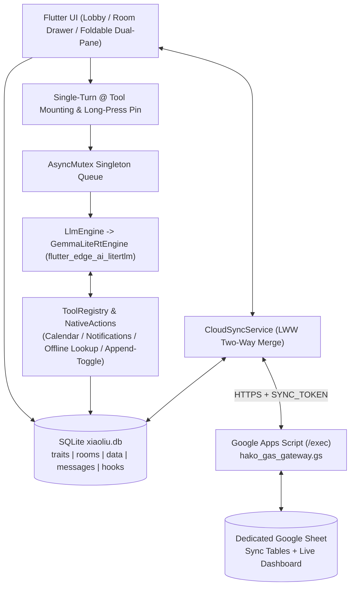

# HAKO
### A Local-First Offline AI Agent with Persistent Room-Based Memory

🛸 **HAKO × KODARI** — Offline Multimodal Android Agent App (Flutter + Gemma 4 LiteRT-LM)

[English](README.md) | [繁體中文](README.zh-TW.md)

> **"One Spirit Sprite, One Dedicated Workspace."**  
> A Local-First, offline multimodal AI Agent built with **Flutter + Gemma 4 LiteRT-LM**. Zero model-gallery menus—launch straight into a single on-device `Gemma-4-E4B-it.litertlm` engine for offline vision, PARA memory & task management, native Android actions, and serverless two-way sync via Google Apps Script.

**Technical Summary**

- **Local-First Architecture** — All rooms, messages, memory and hooks live in on-device SQLite (`KODARI.db`); cloud sync (clipboard / Google Sheet + GAS) is optional.
- **Offline AI Agent** — Inference runs on-device with Gemma 4 E4B via LiteRT-LM; no cloud LLM is required.
- **Persistent Room-Based Workspace** — PARA-style rooms keep their own chat history and todos across app restarts.
- **Room-Based Context Management** — Each room rebuilds its session from its own rolling summary plus un-summarized messages, with idle / room-switch compaction.
- **Hierarchical Memory** — Global persona & distilled long-term `MEMORY.md` → per-room rolling summary → recent messages; cross-room search from the main room.
- **Local Tool / Hook Execution** — Single-turn `@` tools and Android native actions run locally; user-registered formula hooks are evaluated on-device.

> One agent (KODARI) working across multiple rooms — not a multi-agent system.

---

## ✨ Key Architectural Highlights

1. **Single-Model Hardlock & Zero-Menu Launch Gate**
   - Silently checks `/sdcard/Download/` on startup for `gemma-4-E4B-it.litertlm` (3.7 GB). If found, loads it as an application-level **Singleton** and drops straight into the main workspace; also supports manual file picking, catalog download, or a weight-free fallback preview mode.
   - **Two-Layer Isolation**: Inference is decoupled behind [`LlmEngine`](lib/engine/llm_engine.dart), and personal/domain seed data is isolated in `.gitignore`-protected `*.local.json` files.
2. **On-Device Reliability & OOM Protection**
   - **`AsyncMutex` Thread Guard** ([`async_mutex.dart`](lib/core/async_mutex.dart)): Serializes background session pre-warming, user inference, and idle context compaction on a single mutex queue to prevent LiteRT-LM C++ thread collisions.
   - **Automatic Image Compression** ([`image_compressor.dart`](lib/core/image_compressor.dart)): Resizes/compresses images before feeding the vision encoder to avoid OOM and keep vision token usage predictable.
   - **Lazy Session Pre-Warming & Context Compactor**: Opens room history from SQLite in `< 20ms`; pre-warms the `ChatSession` only when tapping the input box or camera button, and compacts long conversations during idle/room-switch windows.
3. **Single-Turn `@` Tool Mounting + Long-Press Pinning**
   - Normal chat runs with **zero tool schemas** loaded, preserving scarce on-device context tokens.
   - Typing or tapping `@` mounts only the selected tool schema for that single turn (`@查材料` / `@查公式` / `@記待辦` / `@設鬧鐘` / `@排日曆`), with long-press pinning for consecutive calls. Tool JSON responses are intercepted in Dart to render interactive action cards directly without wasting model tokens.
4. **Matte Industrial Sprite UI & Foldable Responsive Layout**
   - Draws a zero-texture-overhead geometric sprite via Flutter `CustomPainter` ([`spirit_avatar.dart`](lib/ui/widgets/spirit_avatar.dart)) with state animations (`idle`, `thinking`, `working`, `done`, `stuck`). Avoids GPU-heavy blur effects to reserve full GPU bandwidth for Gemma 4.
   - Adapts automatically via `LayoutBuilder` between single-column drawer (phones) and dual-pane war-room mode (`>= 600dp` foldables).
   - Includes `📌` manual quick-save pins, `⭐` blurry-photo starring, and a top-right `📋` global inbox.
5. **Local-First SQLite + Serverless Phase 2 Sync**
   - Unified `xiaoliu.db` (`traits` / `rooms` / `data` / `messages` / `hooks`) with `updated_at`, `sync_status`, and soft-delete (`is_deleted`) fields ready for conflict-free sync.
   - Supports **Clipboard Lightning Handoff** (JSON export/import) and **Google Sheet + GAS Two-Way Sync** (with an auto-generated live dashboard sheet).

6. **Desktop 6-Slot Customizable Ghost Wheel (60° symmetric hexagon)**
   - Six freely swappable slots with auto-swap on collision, backed by 14 modular actions (`GhostActionRegistry`) and persisted by `GhostLocalStore`.
   - **In-place execution without opening the app** (`GhostInPlaceExecutors`): flashlight, GPS location report, clipboard-to-todo, in-place voice note, latest-photo evidence capture, today's-todos floating card (direct SQLite read/write), next-schedule countdown, Open-Meteo local weather & wind, quick timer, floating calculator (with mm ↔ Taiwan-chi conversion), cloud dashboard refresh.
7. **V2 Engine & Routers**
   - [`FastPathRouter`](lib/tools/fast_path_router.dart) (zero-compute fast path), [`RoutineScheduler`](lib/tools/routine_scheduler.dart) (daily routines), [`WebSearchService`](lib/tools/web_search_service.dart) (DuckDuckGo + cloud fallback).
   - 🚩 on-site correction self-reflection, repeat-loop KV-Flush protection, `/compact` command and memory/context cap control.
   - Removed legacy `gpx_parser.dart` and `hook_runtime.dart`.
   - Verified on Sony Xperia 1 VI and Samsung Z Fold 6 (unfolded wide screen).

---

## 🏗️ Architecture



---

## 📂 Project Structure

```text
lib/
├── core/
│   ├── async_mutex.dart          # Native inference mutex lock
│   ├── image_compressor.dart     # Pre-inference image compression
│   └── token_estimator.dart      # Token estimation & context cap control
├── data/
│   ├── database_helper.dart      # Unified SQLite schema (traits/rooms/data/messages/hooks)
│   └── models.dart               # Room, Message, ActionCard, Tool models
├── engine/
│   ├── llm_engine.dart           # Abstract LLM engine interface
│   └── gemma_litert_engine.dart  # Gemma 4 LiteRT-LM runtime, Auto-Bootstrap & Compactor
├── tools/
│   ├── tool_registry.dart        # @ tool schemas, fallback executor & safe Append/Toggle writes
│   ├── native_actions.dart       # Android calendar intents & local notifications
│   ├── fast_path_router.dart     # Zero-compute fast-path router
│   ├── routine_scheduler.dart    # Daily routine scheduler
│   ├── web_search_service.dart   # DuckDuckGo + cloud fallback search
│   └── tts_service.dart          # Text-to-speech
├── sync/
│   └── cloud_sync_service.dart   # Clipboard handoff & GAS two-way LWW sync
├── ui/
│   ├── screens/                  # SetupGateScreen, HomeScreen
│   └── widgets/                  # SpiritAvatar, ActionCardWidget, Modals
└── main.dart
android/app/src/main/kotlin/com/weilong/xiaoliu/   # Native desktop Ghost Wheel
├── GhostOverlayService.kt        # Floating wheel overlay
├── GhostActionRegistry.kt        # 14 modular action registry
├── GhostLocalStore.kt            # Wheel layout & local storage
└── GhostInPlaceExecutors.kt      # In-place (no app launch) executors
assets/
└── seeds/
    ├── persona_seed.example.json
    ├── profiles.example.json
    └── machine_tuning.example.json
cloud_sync/
└── hako_gas_gateway.gs           # Phase 2 Google Apps Script sync gateway
```

---

## 🚀 Getting Started

### 1. Prerequisites
- **Dart SDK**: `^3.12.0` (Flutter stable)
- **Core Packages**: `flutter_edge_ai: ^2.6.0`, `flutter_edge_ai_litertlm: ^1.20.1`, `sqflite`
- **Target Device**: Android phone (8GB–12GB+ RAM recommended for smooth E4B inference)

### 2. Clone & Configure Local Seeds (Optional)
```bash
git clone https://github.com/sw-cho-serious/Local-First-Offline-AI-Agent-with-Persistent-Room-Based-Memory-Android-Flutter-Gemma-4-LiteRT-L.git
cd Local-First-Offline-AI-Agent-with-Persistent-Room-Based-Memory-Android-Flutter-Gemma-4-LiteRT-L
flutter pub get
```
To customize your persona or offline lookup tables, copy `assets/seeds/*.example.json` to `*.local.json` (ignored by `.gitignore`):
- `assets/seeds/persona_seed.local.json`
- `assets/seeds/profiles.local.json`
- `assets/seeds/machine_tuning.local.json`
- `assets/seeds/skills.local.json`

### 3. Load On-Device Model Weights
Push `gemma-4-E4B-it.litertlm` (~3.7 GB) to `/sdcard/Download/` on your Android device (or pick/download it from the launch gate screen):
```bash
adb push gemma-4-E4B-it.litertlm /sdcard/Download/
flutter run
```

### 4. Phase 2 Cloud Sync Setup (Optional)
1. Create a blank Google Sheet in Google Drive.
2. Open **Extensions ➔ Apps Script**, paste [`cloud_sync/hako_gas_gateway.gs`](cloud_sync/hako_gas_gateway.gs), and optionally set a `SYNC_TOKEN`.
3. Deploy as a **Web App**, then paste the `/exec` URL and token into the `☁️` sync dialog in the app.

---

## 🗺️ Roadmap

- [x] **Phase 1**: Single-model hardlock, SQLite PARA rooms, `@` single-turn tool mounting, geometric sprite UI & native Android actions
- [x] **Phase 2**: Clipboard handoff + serverless Google Sheet / GAS two-way sync
- [ ] **Phase 3 (PRs Welcome!)**:
  - Direct PCM-to-WAV audio input into Gemma 4 (no external STT needed)
  - Lightweight floating bubble for on-screen capture into rooms
  - [x] `hooks` table activated: user-registered formula hooks via `@技能`, evaluated on-device (pure-Dart evaluator; `flutter_js` not used)
  - [x] Desktop 6-slot customizable Ghost Wheel with in-place execution (done)
  - iOS support & broader GPU/NPU backend tuning

---

## 🙏 Credits

- The desktop Ghost Wheel concept is inspired by [vNeeL-code/GHOST](https://github.com/vNeeL-code/GHOST) (MIT). See [THIRD_PARTY_NOTICES.md](THIRD_PARTY_NOTICES.md).
