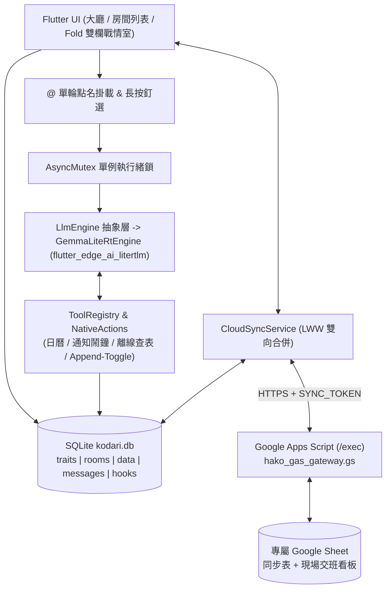

# HAKO
### A Local-First Offline AI Agent with Persistent Room-Based Memory

🛸 **HAKO × KODARI** — 離線多模態 Android Agent App（Flutter + Gemma 4 LiteRT-LM）

[English](README.md) | [繁體中文](README.zh-TW.md)

> **「一顆小精靈，顧一間工作房間」**  
> 專為現場實戰設計的 Local-First 離線多模態 AI Agent（Flutter + Gemma 4 LiteRT-LM）。拔除所有模型展示廳與多層選單，點開即直達本機單一 `Gemma-4-E4B-it.litertlm` 引擎，離線看圖、管理 PARA 記憶與待辦、呼叫原生手腳，並透過零伺服器費的 Google Apps Script 閘道實現跨裝置雙向同步。

**技術摘要**

- **Local-First Architecture** — 房間、對話、記憶與 hooks 全存在本機 SQLite（`KODARI.db`）；雲端同步（剪貼簿 / Google Sheet + GAS）為選用。
- **Offline AI Agent** — 以 LiteRT-LM 在手機端執行 Gemma 4 E4B 推論，不需雲端 LLM。
- **Persistent Room-Based Workspace** — PARA 房間各自保存對話紀錄與待辦，重開 App 仍在。
- **Room-Based Context Management** — 每間房以自己的滾動摘要＋未摘要訊息重建 Session，閒置或切房時自動壓縮。
- **Hierarchical Memory** — 全域人設與蒸餾長期記憶 `MEMORY.md` → 房間滾動摘要 → 近期訊息；主房間可跨房搜尋記憶。
- **Local Tool / Hook Execution** — `@` 單輪工具與 Android 原生動作在本機執行；使用者註冊的公式 hooks 於端側運算。

> 單一 Agent（KODARI）負責多個房間，並非 Multi-Agent 系統。

---

## ✨ 核心設計亮點

1. **單一模型硬鎖與零選單閘門（Single-Model Hardlock）**
   - 啟動時靜默檢查手機 `Download` 目錄是否已存在 `gemma-4-E4B-it.litertlm`（3.7 GB），存在即載入為 Application 級別單例（Singleton）直達大廳；亦支援手動選檔匯入或無模型降級預覽模式。
   - **雙層隔離架構**：透過 [`LlmEngine`](lib/engine/llm_engine.dart) 抽象介面解耦推論引擎，並將個人/業務種子資料隔離於 `.gitignore` 保護的 `*.local.json`。
2. **極致端側效能與防呆設計**
   - **`AsyncMutex` 原生執行緒互斥鎖**（[`async_mutex.dart`](lib/core/async_mutex.dart)）：確保背景預熱、使用者提問推論與閒置 Context 壓縮依序排隊，避免 LiteRT-LM C++ 執行緒衝突。
   - **圖片壓縮防 OOM**（[`image_compressor.dart`](lib/core/image_compressor.dart)）：多模態圖片送入前自動壓縮，保護裝置記憶體並控制視覺 Token 數量。
   - **按需預熱（Lazy Session）＋ Context Compactor**：點進房間 < 20ms 秒開歷史紀錄；僅在點擊輸入框或相機按鈕時預熱 Session，並於閒置或切房時自動壓縮長對話。
3. **「`@` 單輪掛載 ＋ 長按釘選」工具機制**
   - 平常純聊天 0 工具 Schema 負擔，節省寶貴的端側 Context。
   - 輸入或點擊 `@` 僅在當輪掛載指定工具（`@查材料`、`@查公式`、`@記待辦`、`@設鬧鐘`、`@排日曆`），支援長按釘選連發，並於 Dart 層直接攔截 JSON 渲染互動卡片（不浪費模型算力重述）。
4. **工業風幾何精靈 UI ＆ 雙機自適應排版**
   - 以原生 `CustomPainter`（[`spirit_avatar.dart`](lib/ui/widgets/spirit_avatar.dart)）繪製無貼圖負擔的幾何小精靈，隨房間狀態（待命、思考、工作中、完成封存、卡住）切換表情與配件；全程使用高對比深色實色霧面，保留 GPU 算力給模型推論。
   - 支援手機單欄抽屜與摺疊機（`>= 600dp`）左右雙欄戰情室排版。
   - 內建 `📌` 手動補記保險絲、`⭐` 辨識失敗照片標星暫存，以及右上角 `📋` 全局未處理收件匣。
5. **Local-First SQLite ＋ P2 雙機交班同步**
   - 全 App 共用單一 `kodari.db`（`traits` / `rooms` / `data` / `messages` / `hooks`），每張表皆內建 `updated_at`、`sync_status`、`is_deleted`（軟刪除防雲端復活）。
   - 支援 **剪貼簿閃電交班（JSON 匯出/匯入）** 與 **Google Sheet + GAS 雲端自動雙向同步**（附自動彙整的現場交班看板）。

6. **桌面懸浮六軌自訂輪盤（Ghost Wheel，60° 對稱六邊形）**
   - 6 軌可自由替換、撞位自動交換，共 14 項模組化動作（`GhostActionRegistry`），設定存於 `GhostLocalStore`。
   - **免開 App 原地執行**（`GhostInPlaceExecutors`）：手電筒、GPS 報位置、剪貼簿快貼待辦、原地語音速記、相簿最新照存證、今日待辦懸浮卡（直讀寫 SQLite）、下個排程倒數、Open-Meteo 現地天氣／風速、快速計時器、懸浮計算機（含 mm ↔ 台尺換算）、雲端戰情板刷新。
7. **V2 引擎與路由器**
   - [`FastPathRouter`](lib/tools/fast_path_router.dart) 零算力快路徑、[`RoutineScheduler`](lib/tools/routine_scheduler.dart) 日常排程、[`WebSearchService`](lib/tools/web_search_service.dart)（DuckDuckGo + 雲端 Fallback）。
   - 🚩 現場糾錯自省、重複迴圈 KV-Flush 保護、`/compact` 指令與記憶體上下文上限控管。
   - 已移除舊版 `gpx_parser.dart`、`hook_runtime.dart`。
   - 雙實機驗證：Sony Xperia 1 VI、Samsung Z Fold 6（展開寬螢幕）。

---

## 🏗️ 系統架構圖



---

## 📂 目錄結構

```text
lib/
├── core/
│   ├── async_mutex.dart          # 原生推論執行緒互斥鎖
│   ├── image_compressor.dart     # 圖片壓縮防 OOM
│   └── token_estimator.dart      # Token 估算與上下文上限控管
├── data/
│   ├── database_helper.dart      # SQLite 單庫架構 (traits/rooms/data/messages/hooks)
│   └── models.dart               # Room, Message, ActionCard, Tool 等資料模型
├── engine/
│   ├── llm_engine.dart           # 推論引擎抽象介面
│   └── gemma_litert_engine.dart  # Gemma 4 LiteRT-LM 實作、Auto-Bootstrap、Context 壓縮
├── tools/
│   ├── tool_registry.dart        # @ 工具定義、Fallback 執行器與安全合併寫入
│   ├── native_actions.dart       # Android 日曆 Intent 與本地通知鬧鐘
│   ├── fast_path_router.dart     # 零算力快路徑路由
│   ├── routine_scheduler.dart    # 日常排程
│   ├── web_search_service.dart   # DuckDuckGo + 雲端 Fallback 搜尋
│   └── tts_service.dart          # 語音朗讀
├── sync/
│   └── cloud_sync_service.dart   # 剪貼簿交班 & GAS 雲端雙向同步 (LWW)
├── ui/
│   ├── screens/                  # SetupGateScreen, HomeScreen
│   └── widgets/                  # SpiritAvatar, ActionCardWidget, Modals
└── main.dart
android/app/src/main/kotlin/com/hako/kodari/   # 桌面懸浮六軌輪盤（原生）
├── GhostOverlayService.kt        # 懸浮輪盤 Overlay
├── GhostActionRegistry.kt        # 14 項動作註冊表
├── GhostLocalStore.kt            # 輪盤配置與本機儲存
└── GhostInPlaceExecutors.kt      # 免開 App 原地執行器
assets/
└── seeds/
    ├── persona_seed.example.json
    ├── profiles.example.json
    └── machine_tuning.example.json
cloud_sync/
└── hako_gas_gateway.gs           # Phase 2 Google Apps Script 雙向同步閘道
```

---

## 🚀 環境配置與啟動步驟

### 1. 環境需求
- **Dart SDK**：`^3.12.0`（Flutter 最新穩定版）
- **核心依賴**：`flutter_edge_ai: ^2.6.0`、`flutter_edge_ai_litertlm: ^1.20.1`、`sqflite`
- **建議實機**：Android 裝置（建議 8GB～12GB RAM 以上以流暢運行 E4B 權重）

### 2. 安裝依賴與準備本機設定檔（選填）
```bash
git clone https://github.com/sw-cho-serious/Local-First-Offline-AI-Agent-with-Persistent-Room-Based-Memory-Android-Flutter-Gemma-4-LiteRT-L.git
cd Local-First-Offline-AI-Agent-with-Persistent-Room-Based-Memory-Android-Flutter-Gemma-4-LiteRT-L
flutter pub get
```
若要自訂個人靈魂人設或離線查表資料，可將 `assets/seeds/*.example.json` 複製並重新命名為 `*.local.json`（已預設列入 `.gitignore`，不會被推上公開倉庫）：
- `assets/seeds/persona_seed.local.json`
- `assets/seeds/profiles.local.json`
- `assets/seeds/machine_tuning.local.json`
- `assets/seeds/skills.local.json`

### 3. 放入端側模型權重
將 `gemma-4-E4B-it.litertlm`（約 3.7 GB）放入手機的 `/sdcard/Download/` 目錄（或透過 App 啟動閘門頁面手動選檔匯入 / Catalog 下載）：
```bash
adb push gemma-4-E4B-it.litertlm /sdcard/Download/
flutter run
```

### 4. 設定 Phase 2 雲端同步（選填）
1. 在 Google Drive 新建一份空白 Google 試算表。
2. 開啟「擴充功能」➔「Apps Script」，貼上 [`cloud_sync/hako_gas_gateway.gs`](cloud_sync/hako_gas_gateway.gs)（建議設定自訂 `SYNC_TOKEN`）。
3. 部署為 **網頁應用程式（Web App）**，將取得的 `/exec` 網址與 Token 貼進 App 右上角 `☁️` 設定即可。

---

## 🗺️ 開發路線圖（Roadmap）

- [x] **Phase 1**：單模型直開、SQLite PARA 房間隔離、`@` 單輪掛載、幾何精靈與原生系統手腳
- [x] **Phase 2**：剪貼簿閃電交班 ＋ Google Sheet / GAS 零伺服器雙向同步
- [ ] **Phase 3（歡迎 PR 貢獻）**：
  - 原生 PCM→WAV 語音直通 Gemma 4
  - 輕量螢幕懸浮球（讀取當前畫面快速建檔）
  - [x] 已啟用 `hooks` 表：透過 `@技能` 註冊自訂公式技能，於端側運算（pure-Dart 求值器，未使用 `flutter_js`）
  - [x] 桌面懸浮六軌自訂輪盤與原地執行（已完成）
  - iOS / 更多 GPU / NPU Backend 自動適配優化

---

## 🙏 致謝

- 桌面 Ghost 輪盤概念致敬並改作自 [vNeeL-code/GHOST](https://github.com/vNeeL-code/GHOST)（MIT 授權），詳見 [THIRD_PARTY_NOTICES.md](THIRD_PARTY_NOTICES.md)。
